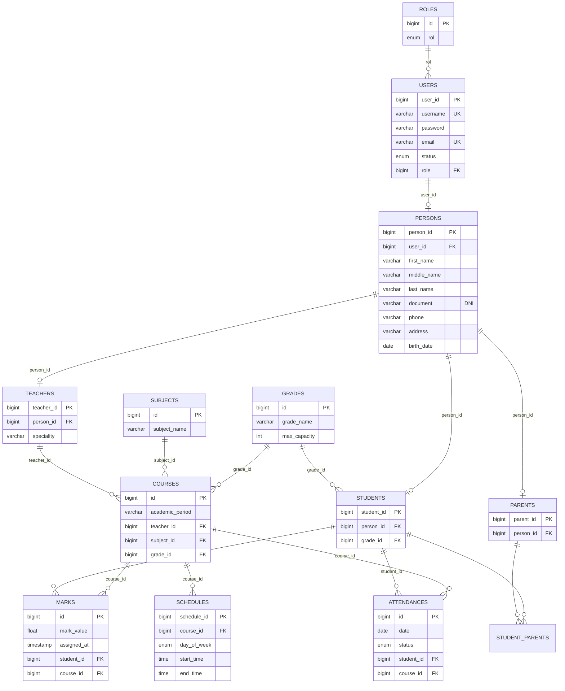

# EduManage

Sistema integrado **SaaS para colegios rurales** que acerca a los padres al proceso académico de sus hijos, permitiéndoles supervisar en todo momento su rendimiento escolar: calificaciones, asistencia y organización académica.

> 📄 Especificación funcional detallada: ver [CASOS_DE_USO.md](CASOS_DE_USO.md) (actores, requisitos funcionales y casos de uso prioritarios).

---

## Tabla de contenidos

1. [Visión del producto](#1-visión-del-producto)
2. [Stack tecnológico](#2-stack-tecnológico)
3. [Arquitectura del sistema](#3-arquitectura-del-sistema)
4. [Estructura del proyecto](#4-estructura-del-proyecto)
5. [Modelo de dominio](#5-modelo-de-dominio)
6. [Enumeraciones](#6-enumeraciones)
7. [Capa de servicios (lógica de negocio)](#7-capa-de-servicios-lógica-de-negocio)
8. [Configuración y ejecución](#8-configuración-y-ejecución)
9. [Estado actual y roadmap](#9-estado-actual-y-roadmap)

---

## 1. Visión del producto

EduManage nace para resolver una problemática real de los **colegios rurales**: la desconexión entre las familias y el proceso educativo. Por distancia, falta de canales digitales o limitaciones de tiempo, los padres suelen enterarse tarde del rendimiento de sus hijos.

EduManage propone:

- **Acercar a los padres al aula**: portal donde cada padre/tutor consulta el rendimiento académico de sus hijos (notas y asistencia por curso).
- **Supervisión en tiempo real**: docentes registran calificaciones y asistencia; los padres las consultan al instante.
- **Gestión académica centralizada**: administración de grados, materias, cursos, horarios, estudiantes, docentes y tutores.
- **Multi-rol**: ADMIN, TEACHER (docente), STUDENT (estudiante) y PARENT (padre/tutor).
- **Modelo SaaS multi-colegio**: pensado para escalar a varias instituciones rurales con baja fricción de adopción.

### Módulos funcionales previstos

| Módulo | Descripción | Estado |
|---|---|---|
| Gestión de usuarios | Personas, usuarios, roles (admin/docente/estudiante/padre) | 🟡 En desarrollo |
| Estructura académica | Grados, materias, cursos y horarios | 🔵 Modelo definido |
| Rendimiento académico | Calificaciones (`Mark`) y asistencia (`Attendance`) | 🔵 Modelo definido |
| Portal del padre/tutor | Consulta de rendimiento e hijos vinculados | ⚪ Pendiente |
| Notificaciones | Avisos a padres (inasistencias, nuevas notas, comunicados) | ⚪ Pendiente |
| Seguridad y autenticación | Login, JWT, autorización por rol | ⚪ Pendiente |

Leyenda: 🟡 parcialmente implementado · 🔵 modelo de datos listo · ⚪ pendiente

---

## 2. Stack tecnológico

| Tecnología | Versión | Uso |
|---|---|---|
| Java | 21 | Lenguaje principal (toolchain Gradle) |
| Spring Boot | 4.0.2 | Framework base (starters modulares) |
| Spring Data JPA / Hibernate | — | Persistencia ORM |
| Bean Validation | — | Validación de DTOs |
| PostgreSQL | — | Base de datos relacional |
| Gradle | 9.2.1 | Gestión de build y dependencias |
| Lombok | — | Reducción de boilerplate (`@Data`, `@RequiredArgsConstructor`, etc.) |
| JUnit 5 (JUnit Platform) | — | Pruebas |

### Dependencias principales (`build.gradle`)

- `spring-boot-starter-web`
- `spring-boot-starter-webmvc`
- `spring-boot-starter-data-jpa`
- `spring-boot-starter-validation`
- `org.postgresql:postgresql` (runtime)
- `org.projectlombok:lombok` (compileOnly + annotationProcessor)
- `spring-boot-devtools` (desarrollo)

---

## 3. Arquitectura del sistema

Aplicación monolítica con arquitectura en capas clásica:

```
┌─────────────────────────────────────────────┐
│  Capa Web (Controllers REST + Advice)       │  ✅ Completa (10 controllers)
├─────────────────────────────────────────────┤
│  Capa DTOs (entrada/salida sin datos        │  ✅ Completa con Bean Validation
│  sensibles)                                 │
├─────────────────────────────────────────────┤
│  Capa Servicios (lógica de negocio)         │  ✅ Completa (13 servicios)
├─────────────────────────────────────────────┤
│  Capa Repositorios (Spring Data JPA)        │  ✅ Completa (12 repos)
├─────────────────────────────────────────────┤
│  Capa Modelos (entidades JPA)               │  ✅ Completa
├─────────────────────────────────────────────┤
│  PostgreSQL (H2 en memoria para pruebas)    │  ✅
└─────────────────────────────────────────────┘
```

Decisiones de diseño relevantes:

- **DTOs sin datos sensibles**: la conversión entidad → DTO es manual dentro de los servicios; nunca se expone la contraseña ni datos internos.
- **Borrado lógico (soft delete)**: los usuarios, docentes y estudiantes no se eliminan físicamente; su estado cambia a `INACTIVE`. Esto preserva el historial académico.
- **Actualizaciones parciales seguras**: los métodos `update*` solo modifican los campos no nulos del DTO.
- **Roles gestionados en BD**: el servicio busca el `Role` en la tabla `Roles`; si no existe, falla con error descriptivo.
- **Manejo global de excepciones**: `@RestControllerAdvice` estandariza las respuestas de error (`ErrorResponse`) con códigos HTTP adecuados (400, 404, 409, 500).

---

## 4. Estructura del proyecto

Paquete raíz: `com.edumanage.project`

```
edumanage/
├── build.gradle
├── settings.gradle
├── gradlew / gradlew.bat
└── src/
    ├── main/
    │   ├── java/com/edumanage/project/
    │   │   ├── EdumanageApplication.java      # Clase principal (@SpringBootApplication)
    │   │   ├── controllers/
    │   │   │   ├── academic/
    │   │   │   │   ├── AttendanceController.java
    │   │   │   │   ├── CourseController.java
    │   │   │   │   ├── GradeController.java
    │   │   │   │   ├── MarkController.java
    │   │   │   │   ├── ScheduleController.java
    │   │   │   │   └── SubjectController.java
    │   │   │   └── user/
    │   │   │       ├── ParentController.java
    │   │   │       ├── StudentController.java
    │   │   │       ├── TeacherController.java
    │   │   │       └── UserController.java
    │   │   ├── dtos/
    │   │   │   ├── academic/
    │   │   │   │   ├── AttendanceDTO.java
    │   │   │   │   ├── AttendanceSummary.java
    │   │   │   │   ├── CourseDTO.java
    │   │   │   │   ├── GradeDTO.java
    │   │   │   │   ├── MarkDTO.java
    │   │   │   │   ├── ScheduleDTO.java
    │   │   │   │   └── SubjectDTO.java
    │   │   │   ├── common/
    │   │   │   │   └── ErrorResponse.java
    │   │   │   └── user/
    │   │   │       ├── ChangePasswordDTO.java
    │   │   │       ├── ParentDTO.java
    │   │   │       ├── PersonDTO.java
    │   │   │       ├── RoleDTO.java
    │   │   │       ├── StudentDTO.java
    │   │   │       ├── TeacherDTO.java
    │   │   │       └── UserDTO.java
    │   │   ├── exceptions/
    │   │   │   └── GlobalExceptionHandler.java
    │   │   ├── models/
    │   │   │   ├── academic/
    │   │   │   │   ├── Course.java
    │   │   │   │   ├── Grade.java
    │   │   │   │   ├── Schedule.java
    │   │   │   │   ├── Subject.java
    │   │   │   │   └── performance/
    │   │   │   │       ├── Attendance.java
    │   │   │   │       └── Mark.java
    │   │   │   ├── enums/
    │   │   │   │   ├── AttendanceStatus.java
    │   │   │   │   ├── RoleList.java
    │   │   │   │   └── UserStatus.java
    │   │   │   └── user/
    │   │   │       ├── Parent.java
    │   │   │       ├── Person.java
    │   │   │       ├── Role.java
    │   │   │       ├── Student.java
    │   │   │       ├── Teacher.java
    │   │   │       └── User.java
    │   │   ├── repository/
    │   │   │   ├── academic/                  # Attendance, Course, Grade, Mark, Schedule, Subject
    │   │   │   └── user/                      # Parent, Person, Role, Student, Teacher, User
    │   │   └── services/
    │   │       ├── academic/
    │   │       │   ├── AttendanceService.java
    │   │       │   ├── CourseService.java
    │   │       │   ├── GradeService.java
    │   │       │   ├── ParentAcademicService.java
    │   │       │   ├── ScheduleService.java
    │   │       │   ├── StudentAcademicService.java
    │   │       │   ├── SubjectService.java
    │   │       │   ├── TeacherAcademicService.java
    │   │       │   └── performance/
    │   │       │       └── MarkService.java
    │   │       └── user/
    │   │           ├── ParentService.java
    │   │           ├── StudentService.java
    │   │           ├── TeacherService.java
    │   │           └── UserService.java
    │   └── resources/
    │       └── application.properties
    └── test/
        ├── java/com/edumanage/project/
        │   ├── EdumanageApplicationTests.java
        │   ├── controllers/
        │   │   ├── academic/
        │   │   │   └── GradeControllerTest.java
        │   │   └── user/
        │   │       ├── ParentControllerTest.java
        │   │       ├── StudentControllerTest.java
        │   │       └── UserControllerTest.java
        │   └── services/
        │       ├── academic/
        │       │   ├── AttendanceServiceTest.java
        │       │   └── performance/
        │       │       └── MarkServiceTest.java
        │       └── user/
        │           ├── ParentServiceTest.java
        │           ├── TeacherServiceTest.java
        │           └── UserServiceTest.java
        └── resources/
            └── application.properties
```

> Nota: la carpeta `bin/` es salida compilada del IDE (Eclipse) y no forma parte del código fuente.

---

## 5. Modelo de dominio

El dominio se organiza en tres módulos cohesivos:

1. **Personas y usuarios** — identidad, credenciales y roles.
2. **Estructura académica** — grados, materias, cursos y horarios.
3. **Rendimiento académico** — calificaciones y asistencia.

### 5.1 Diagrama entidad-relación



### 5.2 Módulo de personas y usuarios

Todas las entidades usan Lombok (`@Data`, `@AllArgsConstructor`, `@NoArgsConstructor`) y claves primarias `GenerationType.IDENTITY`.

#### `Person` (tabla `Persons`)
Representa los datos personales compartidos por cualquier perfil.

| Campo | Tipo | Restricciones |
|---|---|---|
| `id` (`person_id`) | Long | PK, auto-incremental |
| `firstName` (`first_name`) | String | NOT NULL |
| `middleName` (`middle_name`) | String | opcional |
| `lastName` (`last_name`) | String | NOT NULL |
| `document` | String | NOT NULL (DNI/documento) |
| `phone` | String | opcional |
| `address` | String | opcional |
| `birthDate` (`birth_date`) | LocalDate | NOT NULL |
| `user` | User | 1–1, FK `user_id` |

#### `User` (tabla `Users`)
Credenciales de acceso y estado de la cuenta.

| Campo | Tipo | Restricciones |
|---|---|---|
| `id` | Long | PK, auto-incremental |
| `userName` | String | NOT NULL, UNIQUE |
| `password` | String | NOT NULL |
| `email` | String | NOT NULL, UNIQUE |
| `status` | UserStatus (enum STRING) | ACTIVE / INACTIVE |
| `role` | Role | N–1 |

#### `Role` (tabla `Roles`)
Rol de aplicación almacenado como enum `RoleList` (`EnumType.STRING`): ADMIN, TEACHER, STUDENT, PARENT.

#### `Student` (tabla `Students`)
| Campo | Relación |
|---|---|
| `id` (`student_id`) | PK |
| `person` | 1–1 con `Person` (cascade ALL, FK `person_id`) |
| `grade` | N–1 con `Grade` (FK `grade_id`) |

#### `Teacher` (tabla `Teachers`)
| Campo | Relación |
|---|---|
| `id` (`teacher_id`) | PK |
| `person` | 1–1 con `Person` (cascade ALL, FK `person_id`) |
| `speciality` | String — especialidad docente |

#### `Parent` (tabla `Parents`)
Padre/tutor. Puede tener varios hijos y un hijo puede tener varios tutores.

| Campo | Relación |
|---|---|
| `id` (`parent_id`) | PK |
| `person` | 1–1 con `Person` (cascade ALL, FK `person_id`) |
| `students` | M–N con `Student` vía tabla intermedia `student_parents(parent_id, student_id)` |

### 5.3 Módulo de estructura académica

#### `Grade` (tabla `Grades`) — Grado/año escolar
| Campo | Tipo | Restricciones |
|---|---|---|
| `gradeName` (`grade_name`) | String | NOT NULL |
| `maxCapacity` (`max_capacity`) | Integer | NOT NULL — cupo máximo |

Referenciado por `Student` y `Course`.

#### `Subject` (tabla `Subjects`) — Materia/asignatura
| Campo | Tipo | Restricciones |
|---|---|---|
| `subjectName` (`subject_name`) | String | NOT NULL |

Referenciada por `Course`.

#### `Course` (tabla `Courses`) — Curso (materia impartida en un periodo)
| Campo | Tipo | Restricciones |
|---|---|---|
| `academicPeriod` (`academic_period`) | String | NOT NULL — p. ej. "2026-I" |
| `teacher` | Teacher | N–1 |
| `subject` | Subject | N–1 |
| `grade` | Grade | N–1 |

#### `Schedule` (tabla `Schedules`) — Horario de un curso
| Campo | Tipo | Restricciones |
|---|---|---|
| `dayOfWeek` (`day_of_week`) | DayOfWeek (enum STRING) | NOT NULL |
| `startTime` (`start_time`) | LocalTime | NOT NULL |
| `endTime` (`end_time`) | LocalTime | NOT NULL |
| `course` | Course | N–1 (FK `course_id`) |

### 5.4 Módulo de rendimiento académico

Núcleo funcional del valor para padres: aquí se alimenta lo que el tutor podrá consultar.

#### `Mark` (tabla `Marks`) — Calificación
| Campo | Tipo | Restricciones |
|---|---|---|
| `markValue` (`mark_value`) | double | NOT NULL — nota obtenida |
| `assignedAt` (`assigned_at`) | Timestamp | NOT NULL, se asigna automáticamente con `@PrePersist` |
| `student` | Student | N–1 |
| `course` | Course | N–1 |

#### `Attendance` (tabla `Attendances`) — Asistencia
| Campo | Tipo | Restricciones |
|---|---|---|
| `date` | LocalDate | fecha del registro |
| `status` | AttendanceStatus (enum STRING) | PRESENT / ABSENT / EXCUSED / TARDY |
| `student` | Student | N–1 |
| `course` | Course | N–1 |

---

## 6. Enumeraciones

Ubicación: `com.edumanage.project.models.enums`. Todas se persisten como `STRING`.

| Enum | Valores | Uso |
|---|---|---|
| `RoleList` | ADMIN, TEACHER, STUDENT, PARENT | Rol de la cuenta en `Role` |
| `UserStatus` | ACTIVE, INACTIVE | Estado de la cuenta (soporta borrado lógico) |
| `AttendanceStatus` | PRESENT, ABSENT, EXCUSED, TARDY | Registro de asistencia |

---

## 7. Capa de servicios (lógica de negocio)

Actualmente existen dos servicios en `services.user`. La conversión a DTO es manual y excluye datos sensibles (nunca se devuelve la contraseña).

### 7.1 `UserService`

Operaciones CRUD sobre cuentas de usuario.

| Método | Firma | Comportamiento |
|---|---|---|
| Listar usuarios | `getAllUsers(): List<User>` | Devuelve todos los usuarios |
| Obtener por id | `getUserById(Long id): Optional<User>` | Búsqueda por clave |
| Crear usuario | `saveUser(UserDTO): UserDTO` | Rechaza emails duplicados (`RuntimeException("Email already exists")`); valida que el rol exista en BD; estado inicial `ACTIVE` |
| Actualizar usuario | `updateUser(Long id, UserDTO): UserDTO` | Actualización parcial: solo modifica email, rol o status si vienen no nulos en el DTO |
| Eliminar usuario | `deleteUser(Long id): void` | **Soft delete**: cambia `status` a `INACTIVE` |
| Cambiar contraseña | `changePassword(Long id, String currentPw, String newPw): void` | Verifica la contraseña actual, exige que la nueva sea distinta |

Errores actuales: `RuntimeException` genéricos ("User not found", "Invalid role provided: X", "Incorrect current password", etc.). Pendiente migrar a excepciones personalizadas mapeadas a códigos HTTP.

### 7.2 `StudentService`

Alta y gestión de estudiantes creando en cascada su `User` y `Person`.

| Método | Firma | Comportamiento |
|---|---|---|
| Crear estudiante | `createStudent(StudentDTO): StudentDTO` | Valida email único; crea `User` (rol STUDENT obligatorio en BD, estado `ACTIVE`), crea `Person`, vincula el `Grade` indicado por `gradeId` |
| Listar estudiantes | `getAllStudents(): List<StudentDTO>` | Convierte cada entidad a DTO (sin datos sensibles) |
| Obtener por id | `getStudentById(Long id): StudentDTO` | DTO o excepción si no existe |
| Actualizar estudiante | `updateStudent(Long id, StudentDTO): StudentDTO` | Parcial: solo campos no nulos; permite cambiar de grado validando que exista; devuelve el DTO actualizado |
| Eliminar estudiante | `deleteStudent(Long id): void` | **Soft delete**: desactiva la cuenta `User` asociada |

Método interno `convertToDTO(Student)` expone únicamente: nombres, DNI, fecha de nacimiento, teléfono, dirección, email y username (jamás la contraseña), más el `gradeId` si existe.

> Requisito operativo: la tabla `Roles` debe contener previamente el rol `STUDENT` (y en general todos los de `RoleList`) para poder crear usuarios.

---

## 8. Configuración y ejecución

### 8.1 Requisitos previos

- JDK 21
- PostgreSQL en ejecución local (puerto 5432)
- Una base de datos creada llamada `edumanage`
  ```sql
  CREATE DATABASE edumanage;
  ```
- Opcional: sembrar los roles antes de crear usuarios:
  ```sql
  INSERT INTO roles (rol) VALUES ('ADMIN'), ('TEACHER'), ('STUDENT'), ('PARENT');
  ```

### 8.2 Configuración (`src/main/resources/application.properties`)

```properties
spring.application.name=edumanage

# PostgreSQL
spring.datasource.url=jdbc:postgresql://localhost:5432/edumanage
spring.datasource.username=postgres
spring.datasource.password=admin

# JPA / Hibernate
spring.jpa.hibernate.ddl-auto=update     # genera/actualiza el esquema desde las entidades
spring.jpa.show-sql=true                 # útil para depurar
spring.jpa.properties.hibernate.format_sql=true
spring.jpa.properties.hibernate.dialect=org.hibernate.dialect.PostgreSQLDialect
```

Con `ddl-auto=update` Hibernate crea y actualiza las tablas automáticamente a partir de las entidades (adecuado para desarrollo; en producción usar migraciones).

### 8.3 Comandos

```bash
# Ejecutar en desarrollo (devtools activo)
./gradlew bootRun

# Compilar
./gradlew build

# Ejecutar pruebas
./gradlew test
```

En Windows usar `gradlew.bat`.

---

## 9. Estado actual y roadmap

### 9.1 Estado actual

| Componente | Progreso |
|---|---|
| Modelo de dominio (12 entidades JPA + enums) | ✅ Completo |
| Repositorios Spring Data (12 interfaces) | ✅ Completo |
| Servicios de negocio (13 servicios con DTOs) | ✅ Completo (100%) |
| Controladores REST (10 controladores) | ✅ Completo (100%) |
| Manejo global de errores (`@RestControllerAdvice`) | ✅ Completo |
| Pruebas automatizadas (Unitarias + MockMvc) | ✅ 56 pruebas pasando |
| Seguridad (autenticación/autorización) | ⚪ Pendiente (Fase 2) |
| Migraciones de esquema | ⚪ Esquema gestionado por Hibernate (Fase 5) |

Historial del repositorio: creación del modelo de entidades → capa de repositorios JPA → capa completa de servicios con DTOs y lógica de negocio (CRUDs y consultas especializadas por rol) → capa web REST (10 controladores + GlobalExceptionHandler) → suite integral de pruebas automatizadas.

### 9.2 Roadmap propuesto

**Fase 1 — Exponer la API**
- [x] Controladores REST para User, Student, Teacher y Parent (`@RestController` + validación de DTOs)
- [x] Controladores para Grade, Subject, Course, Schedule, Attendance y Mark
- [x] Manejo global de excepciones (`@RestControllerAdvice`) y respuestas de error consistentes (`ErrorResponse`)
- [x] Endpoints especializados de consulta académica para estudiantes, docentes y padres
- [ ] Paginación y ordenamiento en listados

**Fase 2 — Seguridad**
- [ ] `spring-boot-starter-security`
- [ ] Hash de contraseñas con BCrypt (hoy se almacenan en texto plano)
- [ ] Autenticación JWT y autorización por rol (ADMIN/TEACHER/STUDENT/PARENT)
- [ ] Endpoints de login/logout y refresh tokens
- [ ] Externalizar credenciales de BD fuera del código

**Fase 3 — Funcionalidad orientada a padres**
- [x] Servicio y endpoints para `Parent`: registro y vinculación padre ↔ hijo (`student_parents`)
- [x] Consultas de rendimiento: notas y asistencia por hijo, curso y periodo
- [x] Resumen y métricas de asistencia para el padre (`AttendanceSummary`)
- [ ] Portal web/frontend del padre: interfaz visual consolidada

**Fase 4 — Notificaciones y SaaS**
- [ ] Notificaciones a padres (inasistencias, nuevas notas, comunicados) — correo/SMS según conectividad rural
- [ ] Multi-colegio (multi-tenancy) para escalar el modelo SaaS
- [ ] Reportes y estadísticas avanzadas (promedios ponderados, alertas tempranas)

**Fase 5 — Calidad y DevOps**
- [x] Pruebas unitarias de servicios y pruebas de controladores con MockMvc (56 tests)
- [x] Configuración de pruebas autónoma con base de datos H2 en memoria
- [ ] Migraciones con Flyway/Liquibase en lugar de `ddl-auto=update`
- [ ] Perfiles de configuración (`dev` / `prod`)
- [ ] Documentación interactiva de API (OpenAPI / Swagger UI)

---

*Documento generado para el proyecto EduManage — última actualización: agosto de 2026.*
